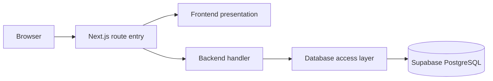

# Single-package full-stack architecture

This project is a full-stack monolith in a unified repository. It uses one Next.js application, one root [package manifest](../package.json), one [lockfile](../package-lock.json) and one deployment. Presentation and server code have explicitly named [frontend](../frontend) and [backend](../backend) folders.

## Folder structure

```text
project/
├── frontend/                          Presentation layer
│   ├── pages/
│   │   ├── home-page.tsx
│   │   ├── catalogue-page.tsx
│   │   ├── course-detail-page.tsx
│   │   └── about/contact/legal/login pages
│   ├── components/                   Header, footer, cards, dialogs, exercise
│   ├── content/                      Explicitly illustrative public view models
│   ├── layouts/
│   │   └── root-layout.tsx
│   └── styles/
│       └── globals.css
├── backend/                           Server layer
│   ├── handlers/
│   │   ├── health.ts
│   │   └── cashfree-webhook.ts
│   ├── config/
│   │   ├── environment.ts
│   │   └── env.ts
│   ├── security/
│   │   └── cashfree-signature.ts
│   ├── scripts/                       Setup, migration and verification tools
│   │   ├── load-env.mjs
│   │   ├── migrate.mjs
│   │   ├── preflight.mjs
│   │   ├── providers.mjs
│   │   └── smoke.mjs
│   └── database/                      Persistence layer
│       ├── supabase.ts
│       └── migrations/
│           └── 202610290001_initial_foundation.sql
├── app/                           Thin Next.js routing adapters
│   ├── layout.tsx
│   ├── page.tsx
│   └── api/
│       ├── health/route.ts
│       └── webhooks/cashfree/route.ts
├── public/                            Original artwork and ambient video
├── tests/                             Tests for the single application
├── docs/
├── package.json                       Only package manifest
├── package-lock.json                  Only dependency lockfile
├── next.config.ts
├── tsconfig.json
└── .env.example                       Root environment template
```

## Request flow



Public routes include `/`, `/courses`, `/courses/[slug]`, `/about`, `/contact` and draft policies. Phase 2 adds real `/login`, `/signup`, recovery/confirmation, account/device and separate staff screens. [Auth route adapters](../app/api/auth) delegate to [auth handlers](../backend/handlers/auth.ts); [staff routes](../app/api/admin) enforce Admin plus MFA. Phase 0 API routes remain `/api/health` and `/api/webhooks/cashfree`. Next.js discovers its route entries in [app](../app); those files delegate to the appropriate layer and declare framework-specific settings.

Application routing lives directly in the root [app folder](../app), and operator tooling lives in [backend/scripts](../backend/scripts). The former root source and scripts folders have been removed. All npm commands still run from the repository root, so environment files, migration paths and generated private artifacts keep their existing locations.

## Layer responsibilities

| Layer                                      | Responsibility                                                                      | Boundary                                                                                                           |
| ------------------------------------------ | ----------------------------------------------------------------------------------- | ------------------------------------------------------------------------------------------------------------------ |
| [Frontend](../frontend)                    | Pages, layouts, styles and future interactive components                            | No direct backend imports or secret/database access; frontend files may be server-rendered by Next.js              |
| [Backend handlers](../backend/handlers)    | Validate requests, enforce permissions, orchestrate operations and return responses | Access persistence through database helpers; keep framework routing configuration in route entries                 |
| [Backend configuration](../backend/config) | Validate configuration and read server secrets                                      | Pure configuration validation can be used by operator scripts/tests; secret access is protected with `server-only` |
| [Backend security](../backend/security)    | Server-side signature and security primitives                                       | No presentation dependencies; crypto primitives are testable without a browser                                     |
| [Database](../backend/database)            | Persistence clients, migration files, RLS and constraints                           | No UI dependencies; service-role keys stay server-side                                                             |

The [ESLint configuration](../eslint.config.mjs) rejects frontend imports of backend modules and backend imports of frontend modules. Server-only guards protect secrets, privileged Supabase clients and webhook handling against accidental browser bundling. If a later feature needs shared serialisable types, introduce a deliberately dependency-free shared module; do not expose backend implementation through a frontend import.

## Database migration continuity

The migration moved from its original provider-specific location to [backend/database/migrations](../backend/database/migrations). Its filename and bytes are unchanged; SHA-256 equality was verified during the move. The migration runner still records the same migration name and checksum, so this folder change does not create a new migration or require reapplying an already-recorded migration.

[The migration runner](../backend/scripts/migrate.mjs) and [database tests](../tests/database.test.ts) now use the new location. No SQL changes or remote database operations were made for this reorganisation.

## Development and deployment

Phase 2 added [server auth helpers](../backend/auth), [the session-refresh proxy](../proxy.ts) and migrations 002/003 in the existing [migration directory](../backend/database/migrations). The server verifies identity and app admission, while database RLS independently rejects private reads from pending, revoked, expired or blocked sessions. Staff operations additionally require the current database role and provider AAL2. The client receives only the needed account/device DTOs; service credentials and email verifiers stay in the backend. See [Phase 2 evidence and runbook](./PHASE-2-STATUS.md).

Run all commands at the repository root. The frontend and backend share dependencies, environment configuration, build output and hosting. Vercel's root directory stays at the repository root. There is no additional Express server, second port, CORS boundary or separate package installation in this structure.

Architecture validation uses the existing checks: lint, strict type checking, configuration/signature/database tests, the Next.js production build and the local HTTP smoke script. Phase 0 provider credentials and external acceptance checks remain pending as recorded in [the status report](./PHASE-0-STATUS.md).
